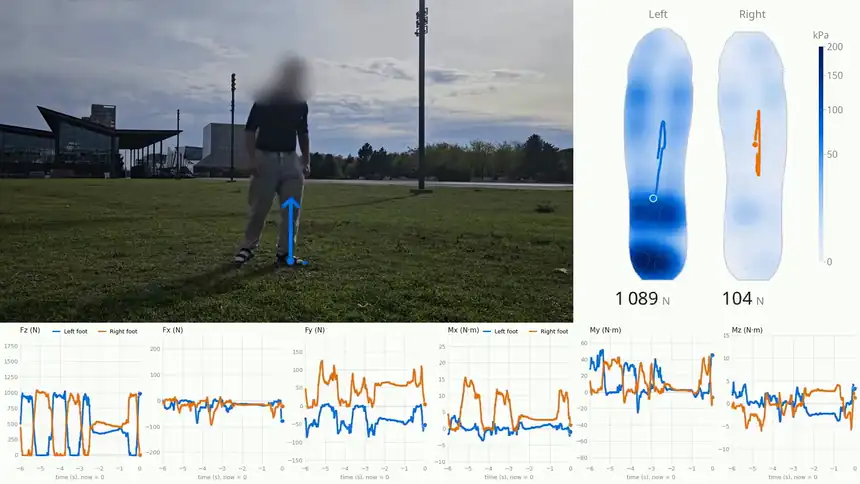

# open-insole

Software and trained models of **OpenInsole**, an open-source pair of instrumented insoles that estimates the six-component ground reaction force and moment (6D GRFM) of each foot in real time.

Each insole carries 15 load cells and four IMUs on four rigid patches. A causal multilayer perceptron reads the last 100 ms of both insoles and outputs the three force and three moment components of each foot; one prediction takes 0.2 ms on one CPU thread, far below the 5 ms between two samples.

<p align="center">
  <a href="https://kahinachb.github.io/open-insole-website/"></a>
  <br><em>Outside the laboratory, the insoles alone estimate the GRFM of each foot (left foot in blue, right foot in orange).</em>
</p>

Project page and video: https://kahinachb.github.io/open-insole-website/

This repository holds the code that records the insoles, turns the recordings into a dataset, trains and evaluates the models, recomputes every number and table of the paper, and runs the live demo. The hardware (PCBs, 3D-printed parts, bills of materials, firmware and assembly guides) is in a separate repository, `open-insole-hardware`, and the dataset is on Zenodo; both are released upon publication of the paper.

## Layout

| Folder | Content |
|---|---|
| `acquisition/` | Recording of a trial (`record_trial.py`), decoding of the insole stream, synchronisation with the force plates and motion capture |
| `calibration_imu/`, `calibration_magnetometer/` | IMU and magnetometer calibrations of both insoles |
| `insole2grfm/` | Dataset builder, training engine, Full CV, evaluation, competitor reproductions (Sabbah 2024, Mahmud 2026), insole characterisation, visualisation |
| `paper/` | The evaluation results behind the paper, and `make_artefacts.py`, which recomputes its numbers and tables from them |
| `demo/` | Live demo: per-foot GRFM estimation and pressure maps in real time, in [Rerun](https://rerun.io) |
| `tools/` | `download_models.py`, the trained models of the paper |
| `docs/` | `pipeline.md` (from raw recordings to a trained model), `guides/recording.md` (recording with the insoles) |

## Installation

Python 3.12:

```bash
python -m venv .venv
.venv/bin/pip install -r insole2grfm/requirements.txt -r acquisition/requirements_synchronization.txt -r demo/requirements.txt
make test PYTHON=.venv/bin/python
```

## Data

The dataset is a Zenodo record, released upon publication of the paper. Download it next to this repository and link its two parts where the code looks for them by default (both are ignored by git):

```bash
ln -s ../OpenInsole-dataset/processed/dataset_v3.7.1 dataset_v3.7.1   # prepared trials: evaluation, training, demo replay
ln -s ../OpenInsole-dataset/raw manip                                  # raw recordings: the pipeline of docs/pipeline.md
```

Every script also takes these paths as arguments.

## Reproducing the paper

`paper/evaluation/` holds the evaluation results of every model of the paper: the error of each model on each test participant, task family and component, under the leave-one-participant-out cross-validation (Full CV), together with the insole characterisation in `paper/characterisation/`. From these files, one command recomputes what the paper reports, without retraining anything:

```bash
make paper-artefacts PYTHON=.venv/bin/python
```

It writes `paper/artefacts/`:

- `numbers.tex`: every number cited in the paper (errors, p values, confidence intervals, costs, timings), one LaTeX macro each;
- `tables/`: the result tables of the paper and of its supplementary material;
- `figures/`: the result figures that need only these files (participant scores, sensor configurations, speed against error).

The gait-cycle figures also need the per-sample predictions of the models, which are not distributed (`make paper-artefacts PREDICTIONS=<results>`). Retraining the models themselves needs the dataset, released upon publication: see [`docs/pipeline.md`](docs/pipeline.md).

## Trained models

The models of the paper are assets of the `v1.0` release. Each run is a leave-one-participant-out cross-validation (Full CV): 15 models, each trained without the participant it is named after.

```bash
python tools/download_models.py        # the main model: MLP with sensor dropout, 78 channels
python tools/download_models.py --all  # also the 28- and 34-channel MLPs, the per-component MLPs and the patch Transformer
```

The models are unpacked into `models/`. With the processed dataset of the Zenodo record (`processed/dataset_v3.7.1/`, released upon publication), each model can be evaluated again on the trials of the participant it was not trained on, by inference only, on a CPU:

```bash
python insole2grfm/evaluate_sensor_configurations.py models/mlp_sensor_dropout_w21/all \
    --data-dir dataset_v3.7.1 --output-dir results/evaluation/mlp --device cpu
```

This predicts the test trials of the 15 folds and scores them as in the paper (`configurations.json` and `evaluation/`); it works the same for the 28- and 34-channel MLPs and the Transformer.

The competitor reproductions (Sabbah 2024, Mahmud 2026) are released as code and evaluation tables; their weights are not distributed.

## Live demo

See [`demo/README.md`](demo/README.md): tare the insoles, then estimate and display the GRFM of each foot live, or replay a recorded session.

## Participants

Participants are named by their Participant code (`P01`…`P15`); a loaded Subject adds `b` for backpack (`P01b`). The evaluation tables and the models are pseudonymised; the correspondence between codes and identities is not released.

## Credits

The mechanical design and the ESP-NOW link were developed with Edik Planson (LAAS-CNRS).

## License

BSD 2-Clause, see [`LICENSE`](LICENSE).
